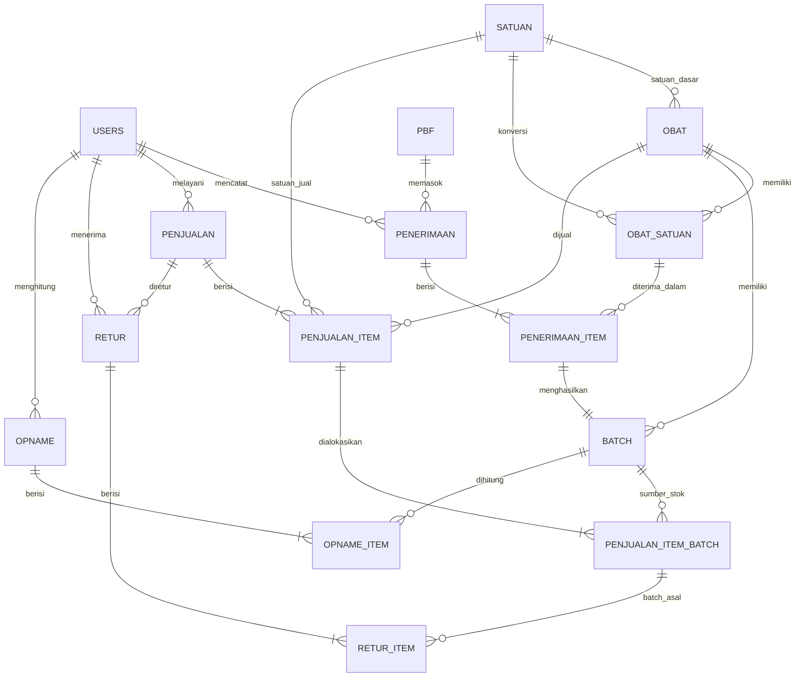

# ERD POS Apotek

`penjualan_item_batch` penting karena satu permintaan, misalnya 15 tablet, dapat dipenuhi oleh 5 tablet dari batch A dan 10 tablet dari batch B. HPP dan retur tetap dapat ditelusuri ke batch tepat.
